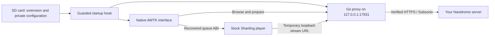

# Navidrome for Shanling M1 Plus

[](https://github.com/shivaluma/shanling-m1plus-navidrome/actions/workflows/ci.yml)

[](LICENSE)

Browse your own music server through a native Shanling interface and hand playback to the stock player.

<p align="center">
  <a href="#on-the-player"></a>
  &nbsp;&nbsp;
  <a href="#on-the-player"></a>
</p>

An independent reverse-engineering project for **Shanling M1 Plus firmware V2.1**. It combines a native C/AWTK extension, a small Go Subsonic proxy and a guarded startup hook. The interface is built from the stock Shanling widgets, theme styles and icons, and the build can merge Be Vietnam Pro into the system font so Vietnamese renders throughout the player.

**Working on an M1 Plus, reported by the device owner.** On 2026-10-10, the owner confirmed a successful firmware update, Navidrome browsing and audible music playback. Host and MIPS emulation checks also pass. Search/T9, seek, hardware controls and sleep/resume still need individual device checks; see the [hardware report](docs/validation/hardware-owner-report.md). This remains experimental, with no ready-to-flash firmware release distributed here. The owner has since flashed `V2.1-ND-dev3`: the Vietnamese system font works and the photos above show the stock-style home page and search screen running on the player. Downloads, the latest responsiveness changes and the other new screens still need device checks.

[Tiếng Việt](README.vi.md) · [Build](docs/build.md) · [Installation and device testing](docs/installation.md) · [Architecture](docs/architecture.md) · [Validation](docs/validation.md) · [Research](docs/research/README.md)

## On the player

Photos from the device owner's M1 Plus (2026-10-10), not mock-ups:

| Navidrome home page | Search |
| --- | --- |
|  |  |
| A swipe-in home page beside the stock pages: Artists, Albums, Playlists, Search, Downloads and Update library, with the stock now-playing bar below. | Search with the stock search box and T9 keyboard, and Songs, Albums and Artists result tabs. |

## Features implemented

- A stock-style home page with Artists, Albums, Playlists and Search tiles.
- Scrolling lists that reuse the stock navigation bar, 60 px rows, round icons and format badges, 50 rows at a time, with instant press feedback and an instant Back that keeps your scroll position.
- Search across songs, albums and artists using the native T9 keyboard and accent-colored result tabs.
- Album and playlist queues with "Play all", up to 128 tracks per chunk, then a jump to the stock Now Playing page.
- Offline downloads of albums and playlists to `Navidrome/` on the SD card (original files and covers, resumable, with a free-space reserve), a Downloads page, and a shortcut to the stock library update so they play without Wi-Fi.
- Vietnamese text in the whole player: Be Vietnam Pro merged into the stock CJK font, plus NFC composition of decomposed metadata.
- HTTPS to your Navidrome server, with certificate and hostname verification.
- Incremental audio streaming with GET/HEAD, Range and If-Range support.
- Local credential setup, an explicit enable marker and optional SD boot diagnostics.
- Stock-application fallback for missing payload, early backend failure or a failing extended application.

The target is **Navidrome and the Subsonic API**. Jellyfin integration, streaming transcoding, scrobbling and direct changes to the local music database are outside the current implementation. Generic Subsonic servers have not been independently validated.

## How it fits together



Only the init-script reference, a launcher and (unless `--stock-font` is chosen) the merged UI font enter the rebuilt rootfs. The backend, plugin and CA bundle stay on the SD card. The original kernel and stock application bytes are preserved.

## Current evidence

| Layer | Evidence | Status |
| --- | --- | --- |
| Go backend | Unit/race tests, TLS, streaming and offline-download fixtures | Passed |
| Native C interface | 22 host scenarios, Darwin UBSAN and Linux ASAN/UBSAN | Passed with mocked toolkit/player |
| UI font | Merge unit tests; every Vietnamese letter rendered through stb_truetype 1.26 | Passed on host; device rendering not yet observed |
| MIPS execution | 19 backend checks (incl. batched preparation and an offline download) and original-library plugin loading | Passed under QEMU P5600 |
| Real Navidrome | Local full-FLAC integration incl. downloads and a server with downloads disabled; authenticated live MIPS browse/search and two audio ranges | Passed in the documented scope |
| Firmware packaging | 3,016 file hashes, 494 symlinks, 208 hardlink groups; unchanged kernel | Passed offline; with the merged font, rootfs 262,144 bytes smaller than stock |
| M1 Plus hardware | `dev2`: update, browsing and audible playback. `dev3`: Vietnamese font, home page and search screen photographed on the player | **Owner-reported success on one player**; remaining checks in the [hardware report](docs/validation/hardware-owner-report.md) |

See [validation details and retained reports](docs/validation.md). Passing emulation tests does not establish device compatibility or recovery.

## Start with host tests

These checks do not require a player or proprietary firmware:

```sh
git clone https://github.com/shivaluma/shanling-m1plus-navidrome.git
cd shanling-m1plus-navidrome
python3 -m venv .venv
. .venv/bin/activate
python -m pip install -r requirements-dev.txt
(cd backend && go test -race ./... && go vet ./...)
python -m unittest discover -s tests -p 'test_*.py' -v
python -m unittest discover -s packaging -p 'test_rebuild.py' -v
```

The native host harness additionally needs Clang and libcurl development headers; see [testing](docs/testing.md). To build the MIPS extension and experimental update container, follow [the build guide](docs/build.md) with your own matching V2.1 firmware.

## Repository map

| Path | Purpose |
| --- | --- |
| `backend/` | Loopback-only Go Subsonic client and streaming proxy |
| `native/` | Native interface, startup interposer and recovered ABI declarations |
| `scripts/` | Input preparation, build, ELF checks, SD setup and diagnostics |
| `packaging/` | Metadata-preserving SquashFS repacker and restore-draft builder |
| `analysis/` | Static container inspection, ELF inventory and disassembly tools |
| `tests/` | Setup, launcher, diagnostics, native host and MIPS runtime checks |
| `docs/` | Build, device testing, architecture, validation and research notes |

Firmware, extracted vendor libraries, private configuration, toolchains and generated images are local build inputs/outputs and are excluded from Git.

## Contributing

The most useful next contributions are reproducible hardware results, recovered ABI corrections, large-library behavior and native UI fixes. Start with [CONTRIBUTING.md](CONTRIBUTING.md), the [roadmap](docs/roadmap.md) and [security guidance](SECURITY.md). Report the exact firmware hash and distinguish host/emulation results from device observations.

Project-authored source is MIT licensed. Third-party components retain their licenses; see [THIRD_PARTY_NOTICES.md](THIRD_PARTY_NOTICES.md). This project is independent of Shanling and Navidrome.
