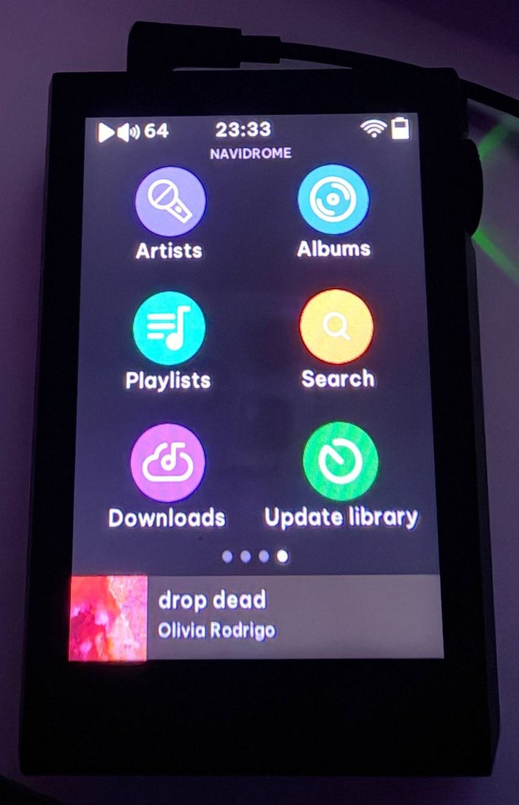
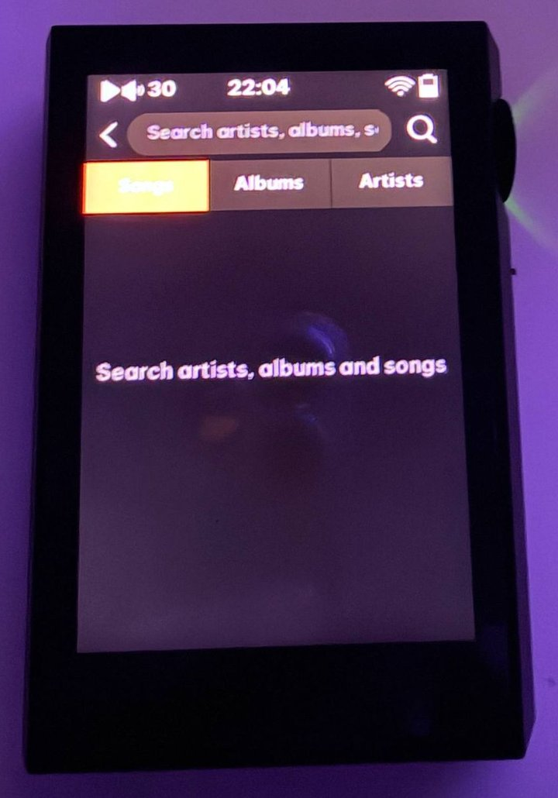

# Navidrome cho Shanling M1 Plus

[English](README.md) · [Build](docs/build.md) · [Cài đặt và kiểm thử](docs/installation.md)

<p align="center">
  
  &nbsp;&nbsp;
  
</p>

Ảnh chụp trên máy thật của chủ máy (2026-10-10): trang Navidrome trên màn hình home và màn hình tìm kiếm.

Dự án reverse engineering độc lập cho **Shanling M1 Plus V2.1**, bổ sung duyệt nghệ sĩ/album/playlist và tìm kiếm server Navidrome ngay trong giao diện native Shanling. Bài được chuyển vào hàng đợi của trình phát gốc. Giao diện dùng lại widget, style theme và icon gốc của Shanling; bản build có thể ghép font Be Vietnam Pro vào font hệ thống để hiển thị tiếng Việt trên toàn máy.

**Đã chạy trên M1 Plus thật, theo xác nhận của chủ máy.** Ngày 2026-10-10, chủ máy xác nhận flash thành công, duyệt Navidrome được và phát nhạc có tiếng. Backend MIPS cũng đã chạy dưới QEMU và thử với Navidrome thật. Tìm kiếm/T9, seek, nút điều khiển và sleep/resume còn cần kiểm tra riêng; xem [báo cáo thiết bị](docs/validation/hardware-owner-report.md). Đây vẫn là bản thử nghiệm; repo chưa phát hành firmware sẵn để flash. Báo cáo đó áp dụng cho giao diện `V2.1-ND-dev2`; giao diện kiểu gốc mới và font tiếng Việt mới chỉ được kiểm thử trên host, giả lập và đóng gói offline.

## Đã triển khai

- Trang home kiểu gốc với 4 ô: Nghệ sĩ, Album, Playlist, Tìm kiếm.
- Danh sách cuộn giống trang gốc: thanh điều hướng, dòng 60 px, icon tròn, 50 dòng mỗi lần tải.
- Tìm bài hát, album, nghệ sĩ bằng bàn phím T9 native với tab màu cam.
- Hàng đợi album/playlist theo nhóm tối đa 128 bài, nút "Play all", rồi chuyển sang màn hình Now Playing gốc.
- Tải album/playlist về thẻ nhớ (thư mục `Navidrome/`) để nghe offline: file gốc kèm ảnh bìa, tải tiếp khi bị ngắt, giữ lại dung lượng trống; trang Downloads và lối tắt cập nhật thư viện gốc.
- Hiển thị tiếng Việt trên toàn máy: font Be Vietnam Pro ghép vào font CJK gốc, chuẩn hóa NFC cho metadata.
- HTTPS có xác minh chứng chỉ; stream theo từng phần và HTTP Range để seek.
- Helper nhập mật khẩu cục bộ, marker bật/tắt và chẩn đoán boot qua thẻ.
- Launcher dùng ứng dụng gốc khi thiếu payload, service lỗi sớm hoặc ứng dụng mở rộng thoát lỗi.

Payload nằm trên thẻ. Rootfs chỉ thêm launcher, thay tham chiếu khởi động và (trừ khi dùng `--stock-font`) thay font giao diện; kernel và chương trình Shanling gốc được giữ nguyên. Cơ chế fallback không phải cách cứu máy không boot.

## Bắt đầu

Chạy kiểm thử host theo [README](README.md#start-with-host-tests). Để build, chuẩn bị firmware V2.1 của bạn theo [hướng dẫn](docs/build.md). Không đưa firmware, mật khẩu hoặc `config.json` lên issue/GitHub.

Sau khi đã build và có phương án thử thiết bị, cấu hình thẻ bằng:

```sh
python scripts/configure.py --sd "/Volumes/TEN_THE_NHO" --server "https://music.example.org/"
```

Thay URL bằng server của bạn. Helper hỏi username/password trong Terminal, xác minh đăng nhập rồi mới ghi cấu hình và bật tính năng. **Mật khẩu được lưu trên thẻ; FAT/exFAT không bảo vệ quyền Unix.** Lệnh này không tự flash.

Theo dõi [bằng chứng kiểm thử](docs/validation.md), [ghi chú reverse engineering](docs/research/README.md) và [roadmap](docs/roadmap.md). Đóng góp và báo lỗi theo [CONTRIBUTING.md](CONTRIBUTING.md).
